<div align="center">

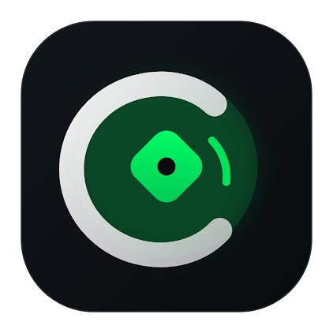

# CampusCrave
### Student Ordering Portal • Hyper-Local Classroom Doorstep Canteen Logistics

**"Your Campus. Your Food. Your People."**

[](https://developer.android.com)
[](https://developer.android.com/jetpack/compose)
[](https://kotlinlang.org)
[](https://m3.material.io)
[](https://stitch.design)
[](https://developer.android.com/topic/architecture)

<p align="center">
  <a href="#-project-overview">Overview</a> •
  <a href="#-the-problem--tri-part-solution">The Problem & Solution</a> •
  <a href="#-design-heritage--stitch-tokens">Design Heritage</a> •
  <a href="#-app-showcase--screen-gallery">Screen Showcase</a> •
  <a href="#-intelligent-campus-logistics">Intelligent Logistics</a> •
  <a href="#-academic-doorstep-matrix">Academic Matrix</a> •
  <a href="#-demo-lab--evaluator-guide">Evaluator Lab</a> •
  <a href="#-quick-start">Quick Start</a>
</p>

</div>

---

## 💡 Project Overview

**CampusCrave** is a proposed college-supported, student-operated food ordering and classroom delivery platform. It unifies students, the campus canteen, and registered student couriers into a single synchronized digital ecosystem.

Rather than burning 25+ minutes of a rigid 40-minute lunch break walking across campus, standing in billing queues, and waiting for food preparation, students can pre-order through this **Native Android Student Portal** and have freshly prepared meals delivered directly outside their lecture room door.

Simultaneously, CampusCrave transforms campus breaks into a **voluntary micro-enterprise earning opportunity** for peer students, who receive transparent commissions per completed delivery without sacrificing academic hours.

> **Scope Note:** This repository hosts the **production-grade Native Android Student Ordering Portal**. It interfaces with the CampusCrave ecosystem consisting of three synchronized pillars:
> 1. **Student Ordering Portal (This Android App):** Discovery, slot pre-ordering, 5s payment handshake, live corridor telemetry, and PIN verification.
> 2. **Canteen Management Portal:** Staff queue manager, batch preparation tickets, and dedicated express collection counter.
> 3. **Student Delivery Partner App:** Voluntary courier assignments, route calculation, and per-drop commission ledger.

---

## 📌 The Problem & Tri-Part Solution

### The Campus Bottleneck

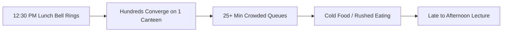

- **For Students:** High friction, lost break time, delayed meals, and academic disruptions. Traditional city-wide delivery apps fail inside colleges because lecture halls lack fixed seat numbering, making in-room seat delivery impossible and intrusive.
- **For Canteen Operators:** Overwhelming lunch rushes, order errors, unpredictable ingredient demand, and zero infrastructure to distribute orders across multiple academic blocks.
- **For Student Earning:** Lack of flexible on-campus micro-earning opportunities that fit within academic timetables and free periods.

### The CampusCrave Solution
1. **Classroom Doorstep Drop Zones:** Food handoffs occur strictly outside lecture room doors. Zero in-class disruption, preserving academic decorum.
2. **Bell-Synchronized Batching:** Pre-orders open 10–20 minutes before the bell, allowing the central canteen to prepare meals in bulk before the rush.
3. **Student Corridor Couriers:** Peer runners navigate stairwells and wings with thermal containers, completing handoffs using a **4-digit PIN**.
4. **DemandCraft™ Feasibility Engine:** Extended-prep dishes are dynamically checked against the lecture resume bell to ensure timely arrival.
5. **SmartStop™ Capacity Halt:** Automatically throttles incoming checkouts when courier workload or kitchen tickets hit peak throughput.

---

## 🎨 Design Heritage & Stitch Tokens

The UI was crafted with the precision of **Stitch** design systems and inspired by the ergonomic mastery, effortless tactile flow, and clean card hierarchy of **Uber Eats**, engineered specifically for high-velocity campus life.

- **Stitch Design Token Fidelity:** Built from the Stitch "Campus Crave Minimal UI" specification.
- **Ergonomic Micro-Interactions:** Smooth progress transitions, normalized shining sweep shaders across checkout buttons, and tactile category toggles.
- **Official Typography:** Configured with **Plus Jakarta Sans** across all variable weights (Regular 400, Medium 500, SemiBold 600, Bold 700, ExtraBold 800).
- **Zero-Emoji Professional UI:** Strict typographic hierarchy and Material 3 vector iconography throughout all customer-facing surfaces.

| Stitch Token | Hex Code | Visual Role |
| :--- | :--- | :--- |
| **Obsidian Deep Black** | `#0B0F12` | Primary interactive buttons, typography headers, and active chip states |
| **Electric Emerald** | `#00E05A` | Primary brand accent, live radar telemetry beacons, and verified badges |
| **Emerald Container** | `#ECFDF5` | Soft background pills, delivery destination badges, and highlight cards |
| **Emerald Dark** | `#065F46` | High-contrast readable typography on mint surfaces |
| **Coral Accent** | `#FF4D4D` | SmartStop capacity warnings, urgent cutoff notices, and discount tags |
| **Canvas Background** | `#F8F9FA` | Low-glare, anti-fatigue screen backdrop |
| **Surface Pure White** | `#FFFFFF` | Elevated cards, bottom navigation island, and modal sheets |

---

## 📱 App Showcase & Screen Gallery

All screens captured directly from a physical Android device (`1080x2392`, Android 14).

### 1. Onboarding & Academic SSO Access
Seamless, zero-friction entry tailored to university credentials and lecture blocks.

| 01. Doorstep Onboarding | 02. Student Access & Block Selection |
| :---: | :---: |
| 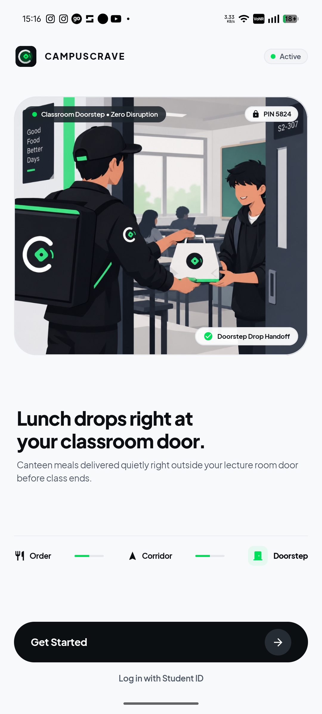 | 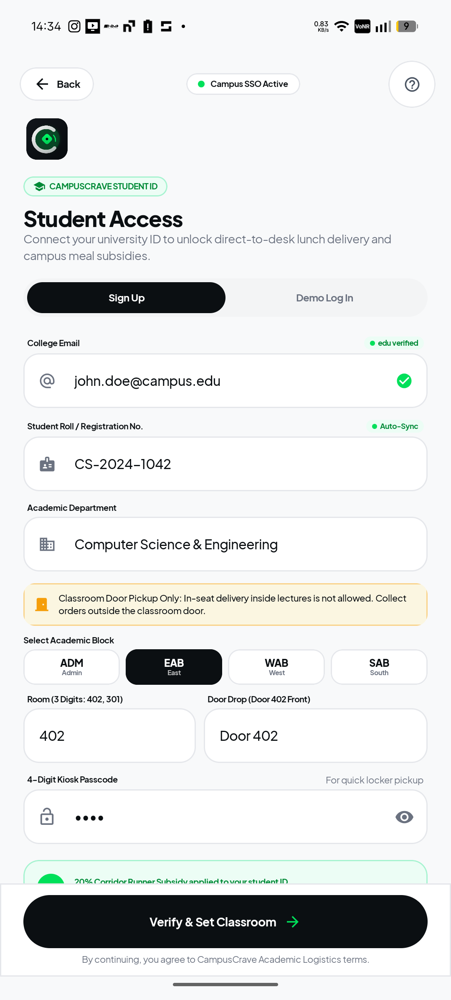 |
| *Classroom doorstep handoff illustration, zero-disruption delivery policy, and one-click student login.* | *Campus SSO, roll registration, 4 academic block selectors, and 3-digit room configuration.* |

---

### 2. Live Canteen Feed & Beverage Catalog
Real-time schedule capsules, CravePass promotional banners, and authentic Swiggy Instamart beverage assets.

| 03. Live Canteen Feed | 04. Soft Drinks Category | 05. Expanded Chilled Catalog |
| :---: | :---: | :---: |
| 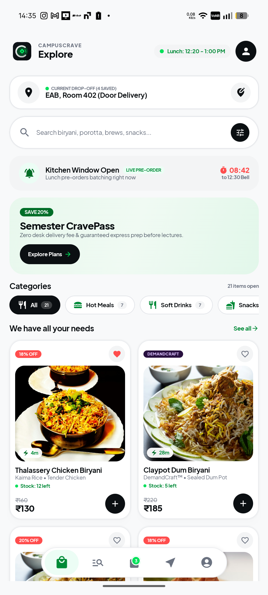 | 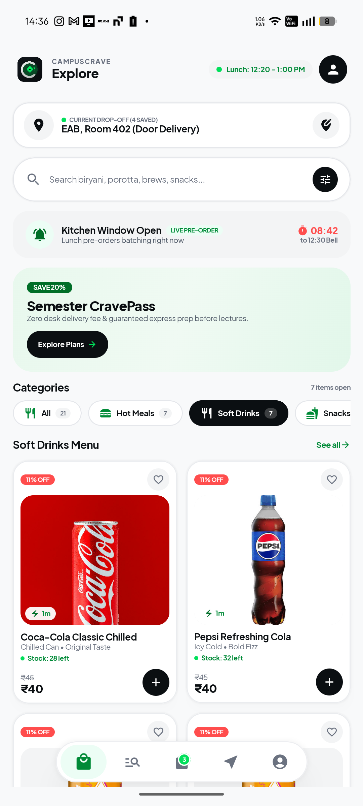 | 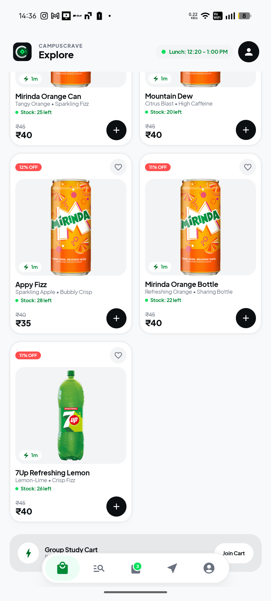 |
| *Active countdown to 12:30 bell, CravePass banner, category tabs, and DemandCraft™ culinary specials.* | *Real Instamart CDN assets for Coca-Cola, Pepsi, and instant add-to-cart controls.* | *Full beverage menu: Mirinda Can, Mirinda Bottle, Mountain Dew, 7Up, and Appy Fizz.* |

---

### 3. Food Detail & Multi-Location Drop-Off Manager
Inspect culinary macros, dietary certifications, and switch between saved campus drop-off zones.

| 06. Food Detail View | 07. Saved Drop-off Locations |
| :---: | :---: |
| 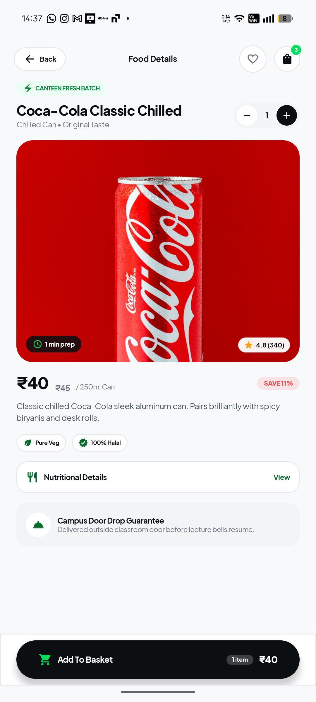 | 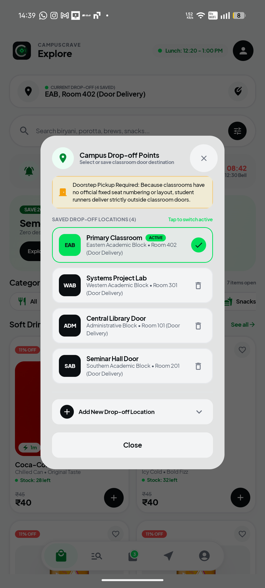 |
| *Prep times, dietary chips (Pure Veg, Halal), nutritional view, and Campus Door Drop Guarantee.* | *1-tap switching between Primary Classroom, Systems Lab, Central Library, and Seminar Hall.* |

---

### 4. Search, Sliders & Basket Checkout
Find food with keyboard auto-focus, dual interactive filter sliders, and full-sweep shining place order button.

| 08. Instant Food Search | 09. Interactive Filter Sliders | 10. Doorstep Basket |
| :---: | :---: | :---: |
| 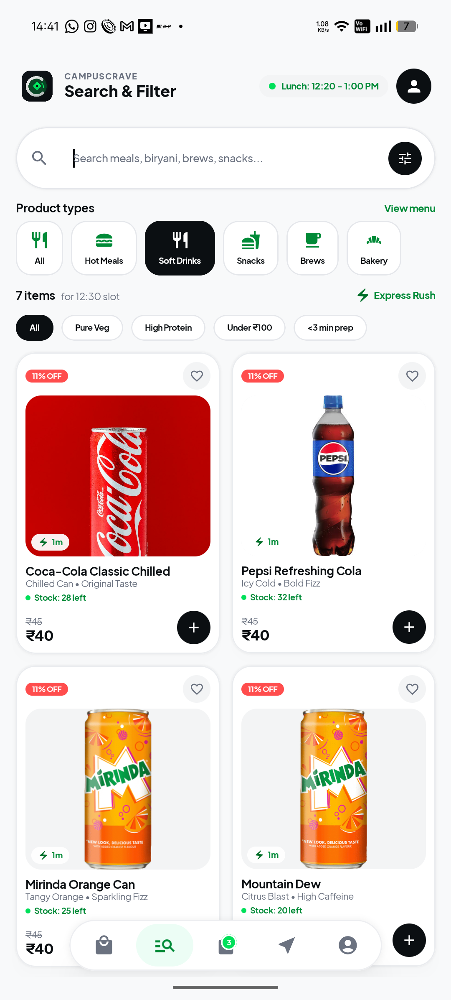 | 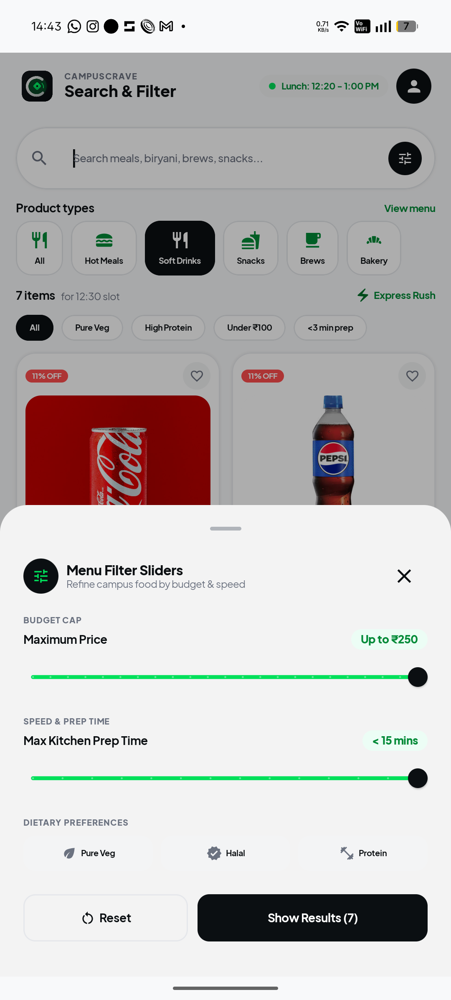 | 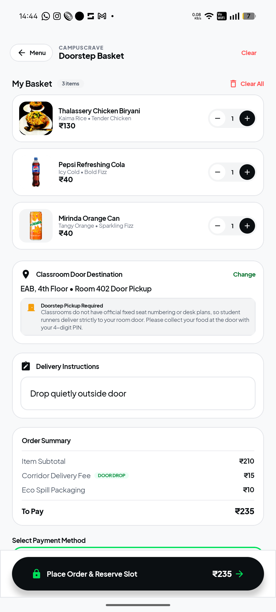 |
| *Direct keyboard launch, quick tags (High Protein, Under ₹100, Fast Prep), and live search.* | *Dual interactive sliders for Maximum Budget Cap (up to ₹250) and Max Prep Time (<15m).* | *Doorstep pickup notice, eco spill packaging, and full-coverage shining Place Order button.* |

---

### 5. Payment Handshake & Real-Time Tracking
5-second student gateway verification and live indoor radar telemetry.

| 11. Lunch Slot Reserved | 12. Live Waypoint Telemetry | 13. Student Courier Card |
| :---: | :---: | :---: |
| 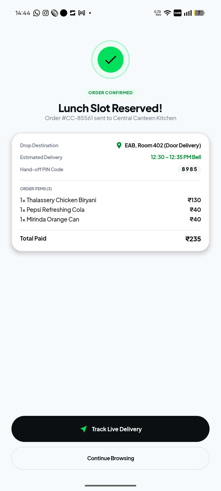 | 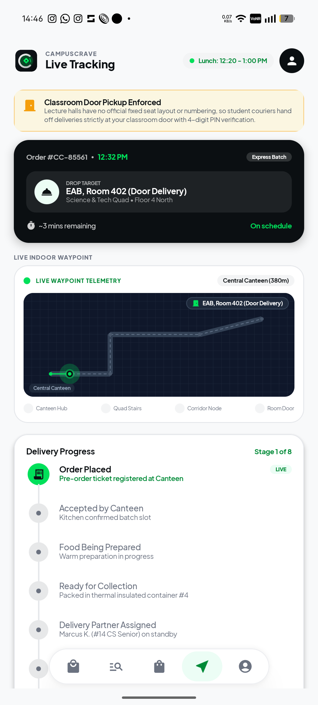 | 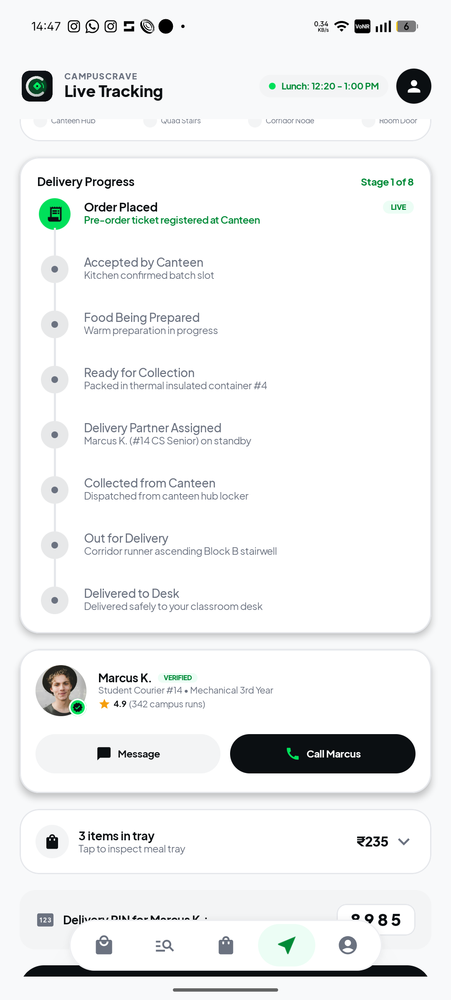 |
| *Order confirmation receipt, 4-digit handover PIN (8985), and scheduled delivery bell window.* | *Real-time radar blueprint tracking runner from Central Canteen through quad stairs to room door.* | *Assigned runner profile (Marcus K. • 4.9 Rating), meal tray inspection, and call/chat actions.* |

---

### 6. Order Completed State, Profile & Subscriptions
Clean terminal states, student profile credentials, and CravePass subscription tiers.

| 14. All Orders Completed | 15. Student Profile & Wallet | 16. Campus CravePass Tiers |
| :---: | :---: | :---: |
| 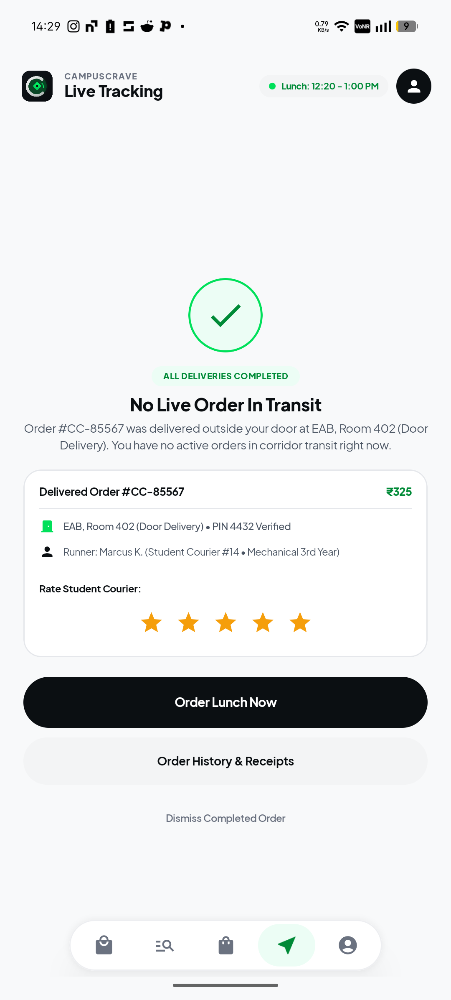 | 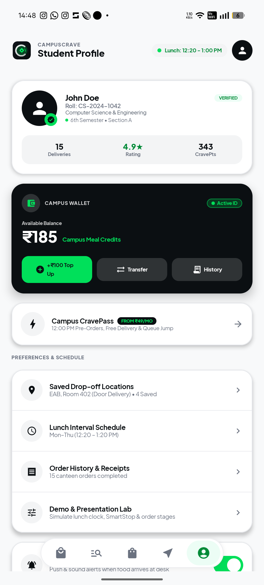 | 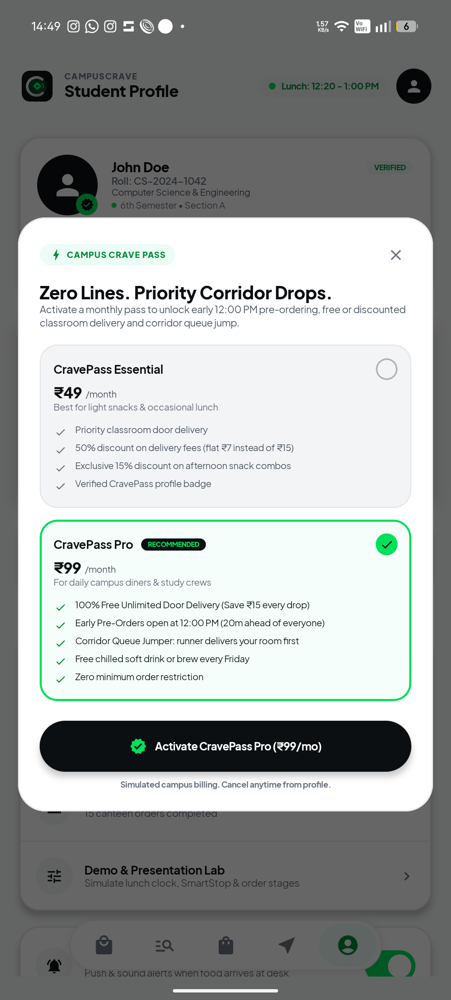 |
| *No live order in flight view with courier star rating, delivery receipt, and reorder shortcut.* | *Sanitized demo student account (John Doe), Campus Meal Credits wallet, and quick top-up.* | *Essential (₹49/mo) and Pro (₹99/mo) benefits with 12:00 PM priority pre-orders.* |

---

### 7. Evaluator Presentation Lab
Built-in simulator designed specifically for live demonstrations and jury evaluations.

<div align="center">
  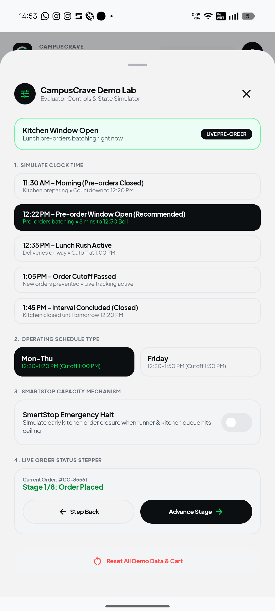
  <p><em>Warp campus clock to any phase, toggle SmartStop emergency halt, and step through all 8 delivery stages.</em></p>
</div>

---

## ⚡ Intelligent Campus Logistics

### 1. Classroom-Aware Delivery Allocation
Instead of generic distance approximations, CampusCrave models the physical campus topography:
- Evaluates courier starting position relative to the **Canteen Express Counter**.
- Computes vertical stairwell transit time across quad academic blocks.
- Accounts for remaining break duration to guarantee student couriers return to their own lecture before the post-lunch bell.

### 2. DemandCraft™ Feasibility Engine
Certain delicacies (such as *Claypot Dum Biryani* or *Stuffed Malabar Porotta Platter*) require extended cooking times (20–30 mins).
- DemandCraft evaluates live kitchen queue load against the student's scheduled class interval.
- If the estimated delivery time exceeds the remaining pre-bell window, the app alerts the user with immediate quick-prep alternatives.

### 3. SmartStop™ Early Ordering Closure
A fixed ordering deadline is insufficient when the canteen kitchen hits capacity. SmartStop continuously monitors:
- Pending unfulfilled tickets in the kitchen batch queue.
- Total active courier workload in the corridors.
- Remaining break minutes.

If total demand breaches courier corridor bandwidth, **SmartStop halts new checkouts in real-time** (e.g., closing at 12:48 PM instead of the 1:00 PM nominal cutoff), protecting the quality of in-flight orders without cancelling existing tickets.

### 4. Simulated 5-Second Gateway Handshake
A 4-step financial settlement verification engine:
1. `Student UPI Node Gateway Handshake`
2. `Campus Token Authorization`
3. `Bank Settlement & Lock`
4. `Canteen Order Acceptance`

---

## 🏛️ Academic Doorstep Matrix

CampusCrave enforces a strict **Classroom Door Drop** policy. Due to differing classroom seating arrangements across departments, delivery inside the lecture hall is strictly prohibited to maintain academic decorum.

| Block Code | Block Name | Typical Rooms | Corridor Routing |
| :--- | :--- | :--- | :--- |
| **`ADM`** | Administrative Block | `101`, `102`, `201` | Central ground gallery & registrar corridor |
| **`EAB`** | Eastern Academic Block | `301`, `402`, `504` | Quad east stairwell & science lecture wings |
| **`WAB`** | Western Academic Block | `201`, `301`, `405` | Systems computing lab & engineering halls |
| **`SAB`** | Southern Academic Block | `101`, `201`, `302` | Seminar complex & postgraduate auditorium |

> **Format Constraint:** All rooms use standard **3-digit university numbering** (e.g., `402`, `301`, `101`).

---

## 💳 Campus CravePass Subscriptions

Designed to reward frequent diners and study groups with zero-friction convenience:

| Benefit | Free Student Tier | CravePass Essential (₹49/mo) | CravePass Pro (₹99/mo) |
| :--- | :---: | :---: | :---: |
| **Pre-Order Opening** | 12:20 PM | 12:15 PM | **12:00 PM (20m Early Access)** |
| **Corridor Delivery Fee** | ₹15 / drop | ₹7 / drop (50% Off) | **100% Free Unlimited Drops** |
| **Queue Priority** | Standard | Priority Batching | **Corridor Queue Jumper** |
| **Minimum Order Limit** | ₹100 | ₹100 | **Zero Minimum Limit** |
| **Weekly Perk** | — | 15% Off Afternoon Combos | **Free Chilled Soda / Brew Every Friday** |

---

## 🕒 College Operating Schedule Rules

CampusCrave synchronizes with official university timetable periods:

```
Monday – Thursday Schedule:
  12:20 PM : Pre-orders Open (Canteen kitchen begins batch prep)
  12:30 PM : Lunch Interval Begins & Courier Dispatch Activates
  01:00 PM : Strict Ordering Cutoff (Tracking remains live)
  01:20 PM : Lunch Interval Concludes (Bell rings)

Friday Schedule:
  12:20 PM : Pre-orders Open
  12:30 PM : Extended Lunch Interval Begins
  01:30 PM : Proposed Cutoff for New Orders
  01:50 PM : Extended Interval Concludes
```

---

## ⚖️ CampusCrave vs. Conventional Food Delivery

| Feature | Conventional Food Delivery | CampusCrave |
| :--- | :--- | :--- |
| **Geographic Scope** | City-wide, generic street addresses | **Hyper-local college campus & corridor blueprints** |
| **Delivery Workforce** | External full-time delivery riders | **Voluntary, compensated student peer couriers** |
| **Handoff Location** | House / building doorstep | **Classroom door outside lecture hall with 4-digit PIN** |
| **Operational Windows** | 24/7 or arbitrary restaurant hours | **Synchronized to college bell timetables** |
| **Kitchen Integration** | Disjointed third-party kitchens | **Direct central canteen portal & dedicated counter** |
| **Capacity Management** | Surge pricing / infinite queueing | **SmartStop™ capacity halt based on break minutes** |
| **Impact on Campus** | Commercial intrusion | **College-supported student micro-enterprise** |

---

## 🛠️ Tech Stack & Clean Architecture

CampusCrave is built with modern Android native development practices:

```
app/
├── src/main/java/com/campuscrave/app/
│   ├── data/
│   │   ├── local/SampleData.kt              # 21 catalog dishes & Swiggy Instamart CDN drinks
│   │   ├── model/
│   │   │   ├── FoodItem.kt                  # Menu item entity with macros & DemandCraft flag
│   │   │   ├── StudentProfile.kt            # Sanitized student profile & SavedDropoff model
│   │   │   ├── Order.kt & OrderStatus.kt    # 8-stage lifecycle & runner assignment
│   │   │   └── ScheduleState.kt             # College schedule & SmartStop state machine
│   │   └── repository/
│   │       └── CampusCraveRepository.kt     # Reactive StateFlow single source of truth
│   └── ui/
│       ├── components/
│       │   ├── TopCampusHeader.kt           # Brand header with new logo & active schedule
│       │   ├── FloatingBottomNav.kt         # Compact icon-only bottom navigation island
│       │   ├── EditClassroomDialog.kt       # Multi-dropoff manager with door pickup policy
│       │   ├── IndoorCorridorMap.kt         # Radar telemetry & campus corridor blueprint
│       │   └── DemoControlsSheet.kt         # Evaluator simulation control center
│       ├── screens/
│       │   ├── welcome/WelcomeScreen.kt     # Modern Compose hero card & corridor steps
│       │   ├── auth/StudentAccessScreen.kt  # University SSO & block selector
│       │   ├── home/HomeScreen.kt           # Countdown timer, CravePass banner & food grid
│       │   ├── discovery/FoodDiscoveryScreen.kt # Search & interactive filter sliders
│       │   ├── details/FoodDetailsScreen.kt # Nutrition breakdown & door drop guarantee
│       │   ├── cart/CartCheckoutScreen.kt   # Dynamic shining sweep & 5s payment modal
│       │   ├── tracking/LiveTrackingScreen.kt # In-flight radar map & delivered empty state
│       │   └── profile/StudentProfileScreen.kt # Campus Wallet & CravePass benefits modal
│       └── theme/
│           ├── Color.kt                     # Obsidian, Electric Emerald, Canvas tokens
│           ├── Type.kt                      # Plus Jakarta Sans typography system
│           └── Theme.kt                     # Material 3 dynamic styling
```

---

## 🚀 Quick Start & Installation

### Prerequisites
- Android Studio Ladybug / Koala / Hedgehog
- Android SDK API 34 (Android 14)
- JDK 17

### Build & Run from Source
```powershell
# Clone the repository
git clone https://github.com/your-org/CampusCrave.git
cd CampusCrave

# Compile the debug APK
.\gradlew.bat assembleDebug

# Install directly to your connected Android phone via ADB
adb install -r app\build\outputs\apk\debug\app-debug.apk

# Launch the app
adb shell am start -n com.campuscrave.app/.MainActivity
```

### Pre-Compiled APK Location
The latest compiled debug build is ready for installation:  
📁 `app/build/outputs/apk/debug/app-debug.apk`

---

## 🎯 Evaluator Demo Script (5-Minute Walkthrough)

To present the prototype to college management, academic evaluators, or investors:
1. **Launch App:** Open `WelcomeScreen` and observe the branded classroom doorstep handoff artwork. Tap **"Get Started"**.
2. **SSO Access:** Select **`EAB`**, room **`402`**, and tap **"Verify & Set Classroom"**.
3. **Explore Menu:** On `HomeScreen`, tap the **"Soft Drinks"** category to view real Instamart CDN items (Coca-Cola, Pepsi, 7Up, Mirinda). Notice the **`DemandCraft™`** badge on *Claypot Dum Biryani*.
4. **Manage Locations:** Tap the location card at the top of the feed to open the **Campus Drop-off Points** popup and switch to *WAB 301* or *ADM 101*.
5. **Add to Basket & Checkout:** Add items to cart. Tap the **Basket** tab. Notice the minimum order validation (₹100) and observe the **shining sweep animation** covering the Place Order button.
6. **5-Second Payment Simulation:** Tap **"Place Order & Reserve Slot"** to trigger the 5-second animated gateway handshake.
7. **Live Tracking:** Inspect the live indoor waypoint radar from Central Canteen to Room 402, review courier *Marcus K.*, and check the 4-digit verification PIN.
8. **Demo Lab Control:** Navigate to Profile > **Demo & Presentation Lab** to simulate schedule cutoffs or advance tracking stages on demand.

---

<div align="center">
  <sub>Built with precision for university life. Designed with Stitch. Inspired by Uber Eats. © 2026 CampusCrave Logistics. All rights reserved.</sub>
</div>
